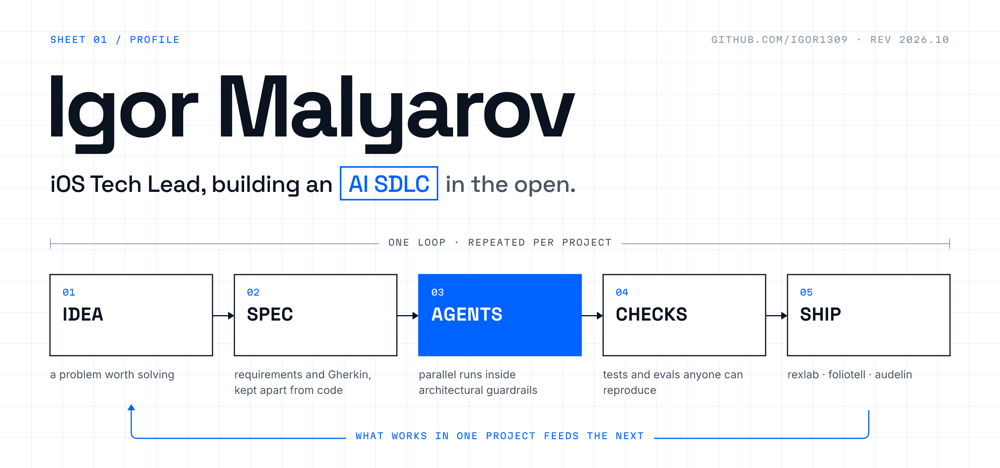
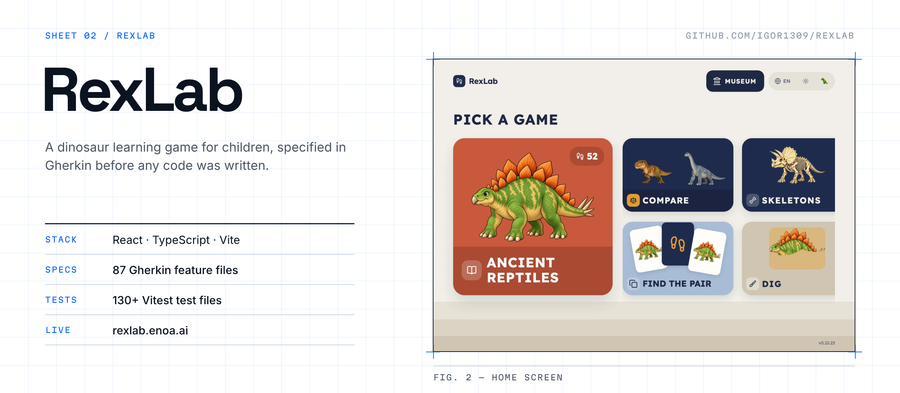
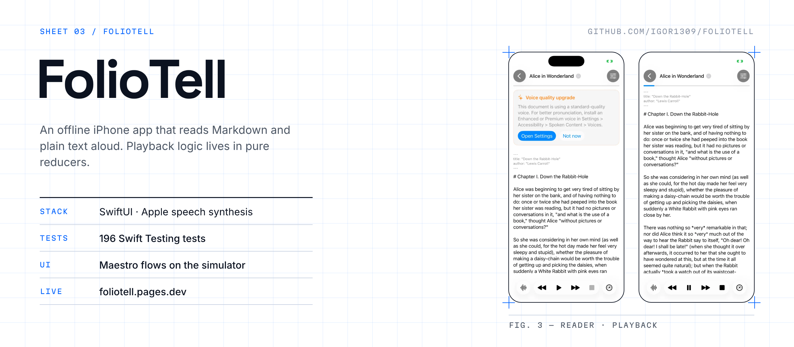

<a href="https://github.com/igor1309">
  <picture>
    <source media="(prefers-color-scheme: dark)" srcset="assets/profile/hero-dark.png">
    
  </picture>
</a>

  <a href="http://igor1309.dev">Blog</a> ·
  <a href="https://www.linkedin.com/in/igor1309/">LinkedIn</a> ·
  <a href="https://t.me/igor1309">Telegram</a>

---

## About Me

I lead iOS development at a bank, build learning products for children, and use agents while studying for a second university degree. Through this work, I am developing an AI SDLC: how to take an idea through to a working result with agents, then keep improving it.

Requirements, specifications, and design decisions are kept independently of the code. This lets me revisit the architecture, change languages, and rebuild a project while preserving what I have learned about the problem. Architectural guardrails and reproducible checks allow multiple agents to work in parallel.

The approach evolves with the projects. I compare models and harnesses on real tasks, develop evals, and examine decisions that did not work out. What helps in one project gets tried in others and incorporated into the shared process.

---

## Showcase

Projects built with AI coding agents, published from my private monorepo with their code and tests.

<a href="https://github.com/igor1309/rexlab">
  <picture>
    <source media="(prefers-color-scheme: dark)" srcset="assets/profile/rexlab-dark.png">
    
  </picture>
</a>

**[RexLab](https://github.com/igor1309/rexlab)** · [play it](https://rexlab.enoa.ai) — React, TypeScript and Vite. Behaviour is specified first in Gherkin (87 feature files) and checked by 130+ Vitest test files. AI coding agents build from those specs and tests.

<a href="https://github.com/igor1309/foliotell">
  <picture>
    <source media="(prefers-color-scheme: dark)" srcset="assets/profile/foliotell-dark.png">
    
  </picture>
</a>

**[FolioTell](https://github.com/igor1309/foliotell)** · [site](https://foliotell.pages.dev) — SwiftUI over Apple speech synthesis. The playback logic lives in a separate library of pure reducers and effect handlers, with 196 Swift Testing tests and Maestro flows on the simulator.

**Next up:** Audelin.

---

## Interests & Focus

- 🧩 **System architecture** — clean modular boundaries, async pipelines  
- 🧪 **Test-Driven Development (TDD)** — strict red–green–refactor discipline  
- 🤖 **AI-powered products & tools** — building intelligent systems and workflows  
- 📱 **iOS / SwiftUI development** — elegant and composable architectures  
- 🌱 **Continuous improvement** — readability, maintainability, craftsmanship  

---

## Tech Stack

**Languages & Frameworks**  
Swift • SwiftUI • Combine • UIKit • async/await • Core Data • CloudKit  
Solid fundamentals in architecture and design in the age of AI allow me to work across a wide range of modern stacks (JavaScript, Node.js, Python, Kotlin, etc.).

**Architecture & Patterns**  
Clean Architecture • SOLID Principles • Design Patterns • Dependency Injection • Modular SPM design  

**Tools & Practices**  
Xcode • Git • GitHub Actions • CI/CD automation • Firebase • Cloudflare Tunnels • Code Review & Mentoring  
Primary tool: the terminal, where I work with AI systems, automation, and orchestration.

---

## Projects

Selected current and experimental projects:
- **Synthesis Engine** — inference pipeline for structured analysis and reflection  
- **Ghost-Writer** — Firebase-hosted publishing system for prompt collections  
- **Prompt Garden** — structured prompt distribution & hosting  
- **Writer’s Room** — collaborative AI-assisted writing environment built on multi-agent dialogue protocols  
- **RxViewModel** — async orchestration experiments using composable reducers  
- **Billable Backend** — modular service layer for managing client billing and usage accounting  
- **Ledger** — transaction-oriented foundation for tracking and reconciling financial operations  

Each project examines the balance between **automation**, **composability**, and **human intent**.

---

## Featured Work
**[EssentialGhibli](https://github.com/igor1309/EssentialGhibli)** — Production-grade iOS architecture demonstration
A comprehensive showcase of hyper-modular architecture implementing SOLID principles through strictly decoupled Swift Package targets. Features include:
- **Modular composition** — isolated development, testing, and deployment of UI, API, and Cache layers
- **Parallel build optimization** — intelligent module dependencies reducing build times
- **Extensive TDD coverage** — snapshot testing for UI states, localization, and dark mode
- **Platform-agnostic design** — generic presentation layer enabling cross-platform reuse
- **CI/CD pipeline** — automated testing and deployment via GitHub Actions

This project demonstrates how architectural discipline, proper abstraction boundaries, and TDD methodology combine to create maintainable, testable, and scalable iOS applications.

---

## Team & Mentorship

I approach teamwork through structure, shared principles, and code — built on technical clarity, autonomy, and steady collaboration.

- 🧭 **Intent-driven development** — clear reasoning before execution  
- 🧪 **Strict TDD discipline** — code that proves its own correctness  
- 🧩 **Autonomy through architecture** — empowering teams via modular design  
- 💬 **Constructive review culture** — code reviews as shared learning  
- 🌱 **Continuous learning** — documentation, mentorship, and growth mindset  

---

## Writing

I write at [igor1309.dev](http://igor1309.dev) when I have something worth sharing — mostly about Swift, architecture, and AI-assisted development, drawn from real work.

---

## Connect

- 💬 [Telegram](https://t.me/igor1309)  
- 🔗 [LinkedIn](https://www.linkedin.com/in/igor1309/)  
- 📝 [Blog](http://igor1309.dev)  
- 🧰 [GitHub](https://github.com/igor1309)